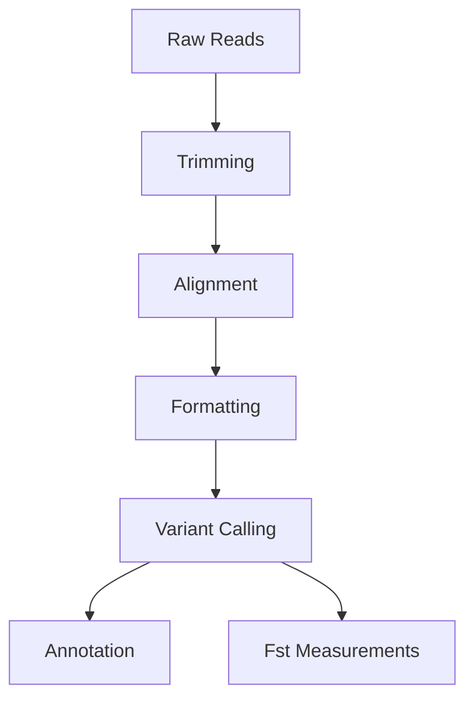

# Methods Used In Workflow


## **Overview**  



## Methods, Software, and Parameters

### Data Procurement  
* NCBI SRA ....  
* Robert's lab sequencing experiments...  

*Description of software and sample selection choices and any inital QC*  

### Trimming 


### Alignment 


### Formating
* ```samtools```
* ```picard```


### Variant Calling 
* ```Free Bayes```

*Describing the QC  measures*   

## Downstream Analysis

### Fst Calculations 
* ```VCFtools```


### Annotation 
* ```Annovar```  

